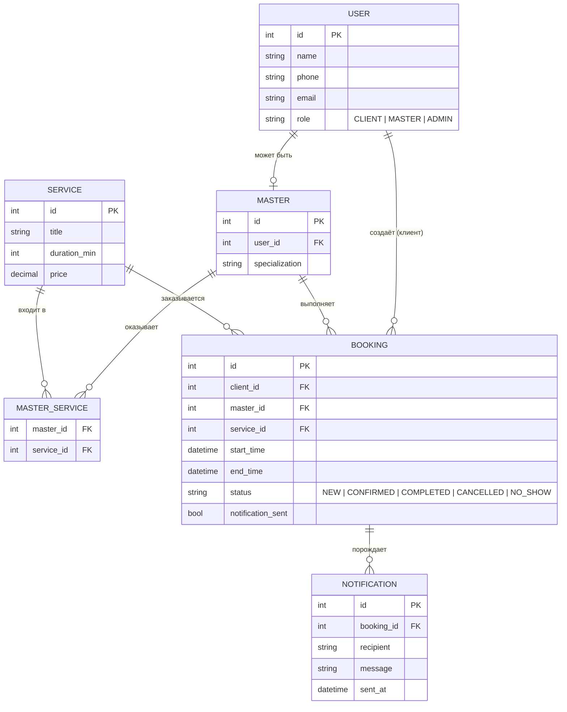
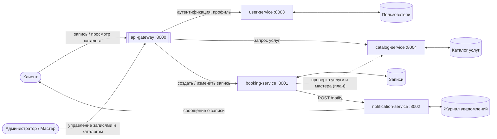
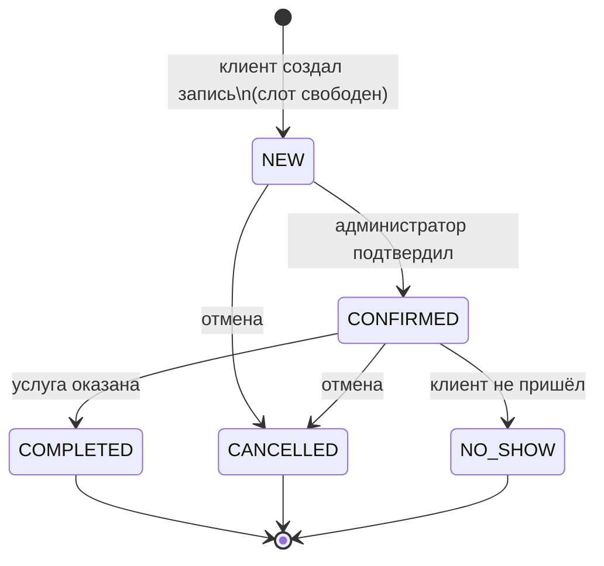

# Beauty Booking - Онлайн-запись в салон красоты

## О проекте
Салон красоты «Beauty Booking» - это информационная система, которая позволяет клиентам записываться на услуги онлайн, не тратя время на звонки. Мастера в это время видят своё актуальное расписание, а администратор управляет услугами и может смотреть отчёты.

Главная проблема, которую решает система - это исключение двойных записей, когда два клиента случайно попадают к одному мастеру на одно и то же время. 

## Бизнес-требования и правила

Система должна закрывать следующие потребности:
- **Для клиента:** быстрый выбор услуги, мастера и свободного времени, а также возможность отменить запись без звонка.
- **Для мастера:** видеть только своё расписание и отмечать, пришёл клиент или нет.
- **Для администратора:** управлять каталогом услуг и контролировать загрузку мастеров.

При этом система обязана строго соблюдать бизнес-правила: запись на одно время к одному мастеру невозможна (защита от накладок); клиент не может отменить запись, если до неё осталось меньше двух часов; услуга должна полностью помещаться в рабочее время мастера.

## Риски проекта и способы их решения

1. **Двойная запись (Критический риск).** Если два человека одновременно нажмут «Записаться» на одно время, может возникнуть коллизия. *Решение:* внутри микросервиса записи используется блокировка, чтобы проверка и сохранение происходили атомарно (в реальном проекте это решается транзакциями в базе данных).
2. **Падение сервиса уведомлений.** Если сервис, который отправляет СМС, упадёт, клиент не получит сообщение. *Решение:* запись всё равно должна создаться, а уведомление просто запишется в лог как неотправленное. Уведомления не должны блокировать основной бизнес-процесс.
3. **Утечка данных.** Персональные данные клиентов не должны попасть в открытый доступ. *Решение:* в перспективе — использование токенов (JWT) и HTTPS.

## Архитектура

Проект построен на микросервисной архитектуре. Вместо одного огромного приложения мы разбили систему на несколько независимых частей, каждая из которых отвечает за своё. Для учебного прототипа мы реализовали два главных сервиса, а остальные спроектировали.

- **booking-service (порт 8001):** Сердце системы. Принимает запросы на запись, проверяет занятость слота и хранит данные.
- **notification-service (порт 8002):** Отвечает за уведомления. Просто принимает сообщение и выводит его в консоль.
- *(В перспективе)* **api-gateway, user-service, catalog-service:** единая точка входа, база пользователей и каталог услуг.

## Диаграммы системы

## Диаграммы

### ER-диаграмма

Здесь показаны основные сущности и связи между ними. Связи между сервисами логические: на уровне баз данных внешних ключей между разными сервисами нет.



### DFD: как данные ходят между сервисами

Клиент и администратор работают только через шлюз. Шлюз передаёт запросы нужному сервису, а каждый сервис работает со своим хранилищем. Сервис записей при создании или изменении записи обращается к сервису уведомлений.



### STD: жизненный цикл записи

Новая запись появляется в статусе `NEW`. Дальше её либо подтверждают, либо отменяют. Подтверждённая запись заканчивается одним из трёх способов: визит состоялся, клиент не пришёл или запись отменили. Из конечных статусов выхода нет.



Слот мастера считается занятым, пока запись в статусе `NEW` или `CONFIRMED`. Как только запись отменяется, слот освобождается. Уведомление уходит при создании, подтверждении и отмене.

## Что может пойти не так

**Двойная запись.** Самый неприятный сценарий: два клиента одновременно пытаются занять одно время у одного мастера. Если проверка и сохранение идут по отдельности, обе записи могут проскочить. В прототипе проверка пересечения интервалов и сохранение выполняются внутри `asyncio.Lock`, поэтому в каждый момент времени в этом участке находится только один запрос. В реальной системе то же самое нужно делать транзакциями в базе данных.

**Падение сервиса уведомлений.** Если бы запись зависела от успешной отправки сообщения, любой сбой уведомлений ломал бы основной сценарий. Поэтому уведомление отправляется после сохранения записи, с тайм-аутом, а ошибка только отмечается в поле `notification_sent`.

**Потеря данных.** В прототипе всё лежит в памяти и пропадает при перезапуске. Для настоящей системы нужна база данных (например, PostgreSQL) у каждого сервиса.

**Доступ к чужим данным.** Сейчас нет авторизации, любой может вызвать любой эндпоинт. Планируется JWT на уровне шлюза, HTTPS и разграничение ролей.

**Рассинхрон между сервисами.** Запись может ссылаться на услугу или мастера, которых уже нет. Для этого в планах проверка через catalog-service и user-service, а позже события и сага для согласования данных.

**Неявки клиентов.** Это бизнес-риск, а не технический. Для него есть статус `NO_SHOW`, а в будущем можно добавить напоминания перед визитом.

**Ошибки в сгенерированном коде.** Код писал ИИ, поэтому его нужно проверять руками. Я запускала сервисы и проверяла основные сценарии, но автотестов пока нет.

## Что уже работает

`booking.py` это сервис записей на FastAPI. Он умеет создавать запись, возвращать список записей с фильтрами по мастеру, клиенту и статусу, менять статус по правилам из диаграммы состояний и отправлять уведомления. Запись в прошлое создать нельзя. Если время мастера пересекается с уже существующей записью, сервис вернёт ошибку 409.

`notification.py` это сервис уведомлений. Он принимает POST-запрос на `/notify`, печатает сообщение в консоль и хранит журнал отправленного, который можно посмотреть на `/notifications`.

Ограничения прототипа: данные хранятся в памяти, блокировка работает только в пределах одного процесса (при нескольких воркерах нужна база), авторизации нет, а три остальных сервиса не реализованы.

## Как запустить

Нужен Python 3.10 или новее.

```bash
python -m venv venv
source venv/bin/activate        # на Windows: venv\Scripts\activate
pip install fastapi uvicorn httpx
```

Сервисы запускаются в двух разных терминалах:

```bash
uvicorn notification:app --port 8002
```

```bash
uvicorn booking:app --port 8001
```

Интерактивная документация открывается в браузере: http://localhost:8001/docs для записей и http://localhost:8002/docs для уведомлений.

## Как проверить

Создаём запись (дата должна быть в будущем, иначе сервис её отклонит):

```bash
curl -X POST http://localhost:8001/bookings \
  -H "Content-Type: application/json" \
  -d '{"client_id":1,"client_name":"Анна","master_id":10,"service_id":5,
       "start_time":"2030-01-15T10:00:00","duration_min":60}'
```

Придёт ответ 201, а в консоли сервиса уведомлений появится сообщение.

Теперь пробуем записать другого клиента к тому же мастеру на пересекающееся время:

```bash
curl -X POST http://localhost:8001/bookings \
  -H "Content-Type: application/json" \
  -d '{"client_id":2,"client_name":"Мария","master_id":10,"service_id":5,
       "start_time":"2030-01-15T10:30:00","duration_min":30}'
```

Сервис вернёт 409, потому что слот занят.

Подтверждаем первую запись:

```bash
curl -X PATCH http://localhost:8001/bookings/1/status \
  -H "Content-Type: application/json" -d '{"status":"CONFIRMED"}'
```

Если попробовать недопустимый переход, например вернуть завершённую запись в `NEW`, снова будет 409.

Чтобы проверить отказоустойчивость, остановите сервис уведомлений и создайте ещё одну запись. Она сохранится, но в ответе будет `"notification_sent": false`.
