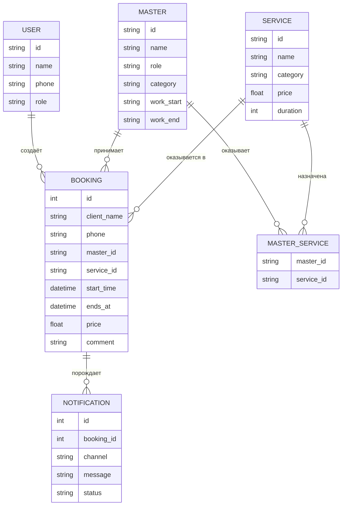
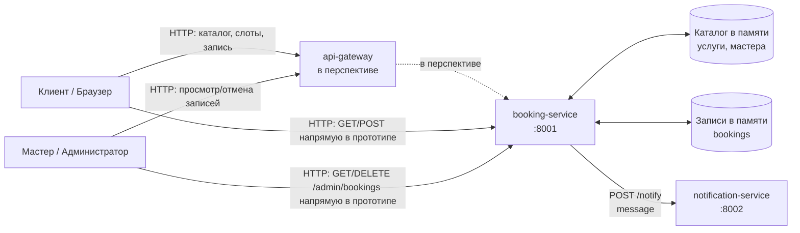
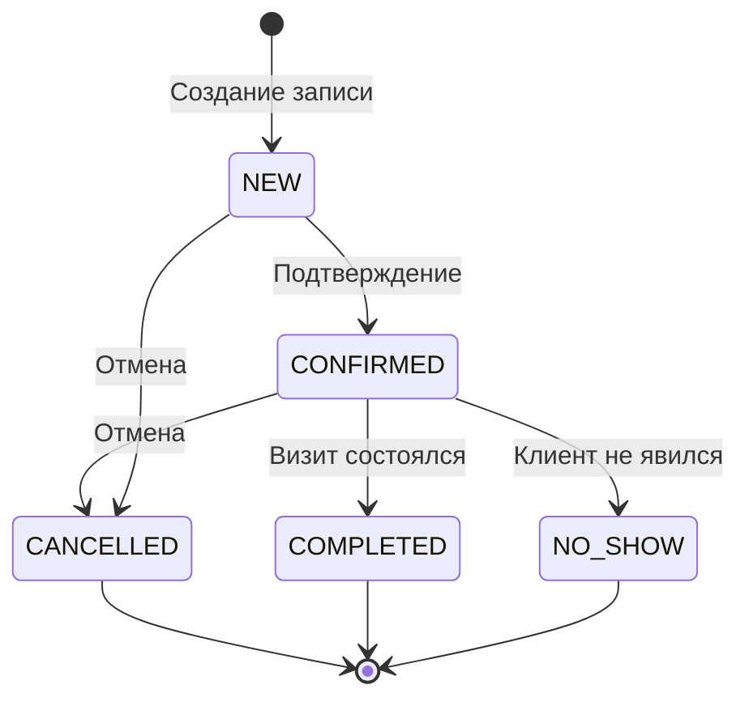

# Beauty Booking - Онлайн-запись в салон красоты

**Beauty Booking** - информационная система онлайн-записи в салон красоты. Система моделирует ключевой сценарий записи клиента к мастеру: выбор услуги и специалиста, просмотр доступных временных окон и фиксация визита без пересечений в расписании.

Система решает типичную проблему небольшого салона: при записи «вручную» (по телефону или в мессенджерах) легко допустить накладку по времени, потерять заявку или не учесть длительность услуги и график мастера. Система переносит эти проверки в программную логику: доступные слоты рассчитываются на основе реальных записей и параметров услуги, а при попытке занять уже занятое окно сервер отказывает в создании записи.

Ключевая идея - **исключение двойных записей**. Для каждого мастера интервалы визитов (`[время начала; время начала + длительность услуги)`) не должны пересекаться. Проверка выполняется при создании записи в критической секции с блокировкой, что защищает расписание от конфликтов в рамках одного процесса сервиса.

## Содержание

- [Бизнес-требования и правила](#бизнес-требования-и-правила)
- [Риски проекта и способы их решения](#риски-проекта-и-способы-их-решения)
- [Архитектура](#архитектура)
- [Диаграммы](#диаграммы)
- [Соответствие требований реализации и проверке](#соответствие-требований-реализации-и-проверке)
- [Ограничения прототипа](#ограничения-прототипа)
- [Как запустить](#как-запустить)
- [Как проверить](#как-проверить)

## Бизнес-требования и правила

### Потребности ролей

**Клиент**
- Просматривать каталог салона: услуги, категории, мастеров, цены и длительности.
- Видеть свободные/занятые временные слоты на выбранную дату для выбранного мастера и услуги.
- Создавать запись онлайн, указывая имя и обязательный номер телефона (при необходимости — комментарий/пожелания).
- Получать подтверждение успешной записи в интерфейсе (веб-страница `index.html`).

**Мастер**
- Просматривать список всех своих записей (личный кабинет `admin.html`): время, имя клиента, телефон, услуга.
- Отменять запись, чтобы освободить временной слот для других клиентов.

**Администратор**
- Контролировать расписание мастеров и записи через административный интерфейс (`admin.html`, работающий с API записей).
- Управление каталогом услуг и мастеров, подтверждение записи администратором, формирование отчётов о загрузке — *(в планах; в прототипе каталог задан статически в коде `booking.py`)*.

### Бизнес-правила

- **Запрет записи на одно время к одному мастеру.** Нельзя создать запись, если её интервал пересекается с существующей записью этого мастера. Реализовано: проверка пересечения интервалов при `POST /bookings`, при конфликте возвращается `409 Conflict` с сообщением `«Это время уже занято, выберите другое»`.
- **Отмена не позднее чем за 2 часа до визита.** *(в планах)* В текущем прототипе мастер может отменить запись в любой момент через `DELETE /admin/bookings/{id}?master=...` без проверки оставшегося времени до визита; отдельного клиентского сценария отмены нет.
- **Услуга должна полностью помещаться в рабочее время мастера.** Реализовано: при создании записи проверяется, что окончание услуги не выходит за границу рабочего времени мастера (`422`, сообщение вида `«Услуга не помещается в график: мастер принимает до HH:MM»`).

Дополнительно в прототипе реализованы сопутствующие правила: запрет записи в прошедшее время, ограничение горизонта записи (`BOOKING_HORIZON_DAYS = 30`), проверка, что мастер работает в выбранный день и оказывает выбранную услугу, валидация имени и номера телефона клиента.

## Риски проекта и способы их решения

1. **Двойная запись (критический).**
   *Риск:* два клиента одновременно бронируют один и тот же слот у одного мастера.
   *Митигация:* расчёт занятости по пересечению интервалов и создание записи внутри `asyncio.Lock` в `booking.py`; при конфликте — `409 Conflict`.
   *Статус:* реализовано в прототипе (в пределах одного процесса). Межпроцессная/распределённая защита — в планах (БД с транзакциями/уникальными ограничениями).

2. **Падение notification-service.**
   *Риск:* сервис уведомлений недоступен, клиент или салон не получают уведомление.
   *Митигация:* изоляция уведомлений в отдельный сервис (`notification.py`, порт 8002), вызов по HTTP с таймаутом (`NOTIFICATION_TIMEOUT = 5.0`), обработка ошибок `httpx.HTTPError`.
   *Статус:* частично реализовано — ошибка отправки перехватывается и логируется (`print`), но сама запись при этом успешно создаётся и возвращается клиенту (`201 Created`). Очередь/повторная доставка — в планах.

3. **Утечка данных.**
   *Риск:* несанкционированный доступ к персональным данным клиентов (имя, телефон, комментарий).
   *Митигация (в планах):* аутентификация/авторизация, разграничение прав ролей, HTTPS, защита административных эндпоинтов, минимизация и защита логов.
   *Статус:* в прототипе не реализовано — авторизации нет, CORS разрешён для всех источников (`allow_origins=["*"]`), админ-эндпоинты доступны без проверки прав.

4. **Потеря данных при перезапуске (in-memory).**
   *Риск:* все записи исчезают при остановке/перезапуске сервиса.
   *Митигация (в планах):* использование постоянного хранилища (СУБД), резервное копирование.
   *Статус:* актуально для прототипа — записи хранятся в списке `bookings` в памяти процесса `booking.py`; при запуске (если `SEED_DEMO` не отключён) создаются демонстрационные записи.

5. **Рассинхрон между сервисами.**
   *Риск:* состояние бронирования и состояние уведомлений расходятся (уведомление не отправлено/отправлено повторно, данные устарели).
   *Митигация (в планах):* надёжная доставка (очередь сообщений, outbox), идемпотентность обработчиков, единый источник истины по записи.
   *Статус:* в прототипе взаимодействие синхронное (`POST /notify`), подтверждения доставки/повторов нет.

6. **Неявки клиентов (NO_SHOW).**
   *Риск:* занятый слот не используется, салон теряет выручку.
   *Митигация (в планах):* статусы визита (`NO_SHOW`), напоминания, политика отмены/подтверждения.
   *Статус:* не реализовано — жизненный цикл со статусами в прототипе не ведётся.

7. **Ошибки в сгенерированном ИИ коде.**
   *Риск:* некорректная бизнес-логика, уязвимости, расхождение документации и фактического поведения.
   *Митигация:* ручная проверка и тестирование сценариев (в т. ч. конфликтов, валидации, недоступности уведомлений), ревью кода, фиксация ограничений в документации.
   *Статус:* частично учтено — в прототипе есть серверная валидация и проверки конфликтов; автотесты отсутствуют (в планах).

## Архитектура

Прототип построен по **микросервисному принципу** (в упрощённом учебном виде): функции бронирования и доставки уведомлений разделены на два независимых процесса, которые взаимодействуют по HTTP. Это позволяет изолировать сбой канала уведомлений от операции создания записи и развивать компоненты раздельно.

### Сервисы

| Сервис | Порт | Статус | Назначение |
|---|---:|---|---|
| `booking-service` (`booking.py`, FastAPI) | `8001` | реализован | Каталог (услуги/мастера), расчёт доступности слотов, создание/просмотр/отмена записей, отправка уведомления о новой записи. |
| `notification-service` (`notification.py`, FastAPI) | `8002` | реализован | Приём уведомлений и вывод их в консоль (эмуляция канала оповещения). |
| `api-gateway` | — | в перспективе | Единая точка входа, маршрутизация, агрегация, защита периметра. |
| `user-service` | — | в перспективе | Учёт пользователей, аутентификация и авторизация по ролям. |
| `catalog-service` | — | в перспективе | Управление услугами, мастерами, расписаниями и ценами (в прототипе каталог статичен в `booking.py`). |

### Взаимодействие сервисов

- Клиентский веб-интерфейс (`index.html`, `admin.html`) обращается к `booking-service` по HTTP (`http://127.0.0.1:8001`): загрузка каталога, проверка доступности, создание и отмена записей.
- `booking-service` при успешном создании записи вызывает `notification-service` синхронным HTTP-запросом:
  - `POST http://127.0.0.1:8002/notify` с телом `{"message": "<текст уведомления>"}` (через `httpx.AsyncClient`, таймаут 5 с).
- `notification-service` обрабатывает запрос и возвращает `{"status": "ok", "message": "Уведомление обработано"}`. При ошибке HTTP-вызова `booking-service` логирует проблему, но не откатывает созданную запись.

## Диаграммы

### ER-диаграмма (целевая модель данных)



*Примечание:* диаграмма отражает целевую модель данных. В текущем прототипе отдельные сущности `USER`, `MASTER_SERVICE`, `NOTIFICATION` как таблицы/хранилища не выделены: каталог мастеров и услуг и связи «мастер–услуга» заданы статическими структурами в `booking.py`, уведомление формируется как сообщение и отправляется в `notification-service` без сохранения истории, отдельного хранилища пользователей нет.

### DFD (диаграмма потоков данных)



### STD (жизненный цикл записи)



**Пояснение:** диаграмма отражает целевой жизненный цикл записи. В текущем прототипе поле статуса у записи не хранится и переходы между статусами не реализованы (нет `PATCH` для смены статуса, нет состояний `NEW/CONFIRMED/COMPLETED/CANCELLED/NO_SHOW`).

**Когда слот считается занятым (в прототипе):** слот занят, если для мастера существует запись, интервал которой пересекается с интервалом запрашиваемой услуги (`start < existing.ends_at` и `existing.time < end`). Пока запись присутствует в хранилище, соответствующее время недоступно; после отмены через `DELETE /admin/bookings/{id}` запись удаляется и слот освобождается.

### Схема архитектуры (компонентная)


*Если изображение не отображается — схема описана в разделе [Архитектура](#архитектура) (таблица сервисов и взаимодействие).*

## Соответствие требований реализации и проверке

| Бизнес-требование | Где реализовано (файл/функция/эндпоинт) | Как проверено (curl-пример / сценарий) |
|---|---|---|
| Запрет двойной записи | `booking.py`: `create_booking` (`POST /bookings`), проверка `overlaps(...)` под `asyncio.Lock`; при конфликте — `HTTP 409`, `detail="Это время уже занято, выберите другое"` | См. «Как проверить», п. 1–2: два `POST /bookings` на одно время/мастера → первый `201`, второй `409`. |
| Отказоустойчивость уведомлений | `booking.py`: `send_notification(...)` отправляет `POST http://127.0.0.1:8002/notify` (`httpx`, таймаут 5 с) и перехватывает `httpx.HTTPError` (логирует ошибку), не прерывая создание записи. `notification.py`: `POST /notify` | См. «Как проверить», п. 5: остановить `notification-service` → `POST /bookings` → `201 Created`, в логе `booking-service` — ошибка отправки уведомления. |
| Запрет записи в прошлое | `booking.py`: `validate_time(...)`, проверка `start < now` → `HTTP 422`, `detail="Нельзя записаться на прошедшее время"` | `POST /bookings` с полем `time` в прошлом → `422`. |
| Смена статуса по правилам STD | Не реализовано (нет поля статуса, нет `PATCH`-эндпоинта) | в планах. |
| Отмена не позднее 2 ч до визита | Не реализовано (в `admin_cancel_booking`, `DELETE /admin/bookings/{id}`, проверка оставшегося времени отсутствует) | в планах. |
| Услуга помещается в рабочее время мастера | `booking.py`: `create_booking(...)` — проверка `end > datetime.combine(start.date(), work_end)` → `HTTP 422`, `detail="Услуга не помещается в график: мастер принимает до HH:MM"`; также `validate_time(...)` проверяет попадание начала в рабочие часы | `POST /bookings` на время, при котором услуга (например, 90 мин) выходит за конец приёма мастера → `422`. |

## Ограничения прототипа

- **In-memory хранилище.** Записи (`bookings`) хранятся в памяти процесса `booking.py`; постоянное хранение и восстановление после перезапуска не реализованы.
- **Блокировка только в пределах одного процесса.** `asyncio.Lock` защищает критическую секцию создания записи внутри одного экземпляра `booking-service`; при горизонтальном масштабировании/нескольких процессах защита от гонок не гарантируется.
- **Нет авторизации.** Отсутствуют аутентификация, роли и контроль доступа; административные эндпоинты (`/admin/...`) не защищены.
- **Часть сервисов не реализована.** `api-gateway`, `user-service`, `catalog-service` присутствуют только как целевая архитектура (в перспективе); каталог в прототипе статичен.
- **Нет автотестов.** Автоматизированные модульные/интеграционные тесты в репозитории отсутствуют; проверка выполнялась сценарно (вручную/через curl и UI).

## Как запустить

Нужен Python 3.10 или новее.

### 1. Создание виртуального окружения

**Linux / macOS:**
```bash
python -m venv venv
source venv/bin/activate
```

**Windows (PowerShell):**
```powershell
python -m venv venv
.\venv\Scripts\Activate.ps1
```

**Windows (cmd):**
```bat
python -m venv venv
venv\Scripts\activate.bat
```

### 2. Установка зависимостей

```bash
pip install -r requirements.txt
```

Содержимое `requirements.txt`:
```text
fastapi
uvicorn[standard]
httpx
```

### 3. Запуск сервисов

Запускать из корня проекта (папка, где находятся `booking.py` и `notification.py`), в отдельных терминалах:

**Сервис записей (booking-service, порт 8001):**
```bash
python -m uvicorn booking:app --host 127.0.0.1 --port 8001
```

**Сервис уведомлений (notification-service, порт 8002):**
```bash
python -m uvicorn notification:app --host 127.0.0.1 --port 8002
```

Интерактивная документация API (Swagger UI):
- booking-service: [http://127.0.0.1:8001/docs](http://127.0.0.1:8001/docs)
- notification-service: [http://127.0.0.1:8002/docs](http://127.0.0.1:8002/docs)

Клиентский интерфейс: открыть `index.html` (рекомендуется через локальный HTTP-сервер, чтобы запросы к API выполнялись корректно). Кабинет мастера: `admin.html`.

## Как проверить

Примеры запросов соответствуют текущей реализации. Дату и время подберите свободные в пределах горизонта записи и рабочего времени мастера.

### 1. Создание записи (успех, 201)

```bash
curl -X POST "http://127.0.0.1:8001/bookings" -H "Content-Type: application/json" -d "{\"client_name\":\"Тест Клиент\",\"master_id\":\"anna\",\"service_id\":\"haircut\",\"price\":55,\"phone\":\"+375291234567\",\"comment\":\"Без сушки\",\"time\":\"2026-11-20T10:00:00\"}"
```

Ожидаемый результат: `201 Created`, тело ответа содержит созданную запись (поля `id`, `client_name`, `master_id`, `master_name`, `service_id`, `service_name`, `price`, `duration`, `phone`, `comment`, `time`, `ends_at`). В консоли `notification-service` выводится сообщение.

### 2. Конфликт по времени (409)

```bash
curl -X POST "http://127.0.0.1:8001/bookings" -H "Content-Type: application/json" -d "{\"client_name\":\"Другой Клиент\",\"master_id\":\"anna\",\"service_id\":\"haircut\",\"price\":55,\"phone\":\"+375291111111\",\"time\":\"2026-11-20T10:00:00\"}"
```

Ожидаемый результат: `409 Conflict`, тело `{"detail": "Это время уже занято, выберите другое"}`.

### 3. Смена статуса (PATCH)

В текущем прототипе **не реализовано** (нет поля статуса и `PATCH`-эндпоинта) — в планах.

### 4. Недопустимый переход статуса (409)

В текущем прототипе **не реализовано** (жизненный цикл со статусами не ведётся) — в планах.

### 5. Отказоустойчивость при недоступном notification-service

1. Остановить процесс `notification-service` (порт 8002).
2. Выполнить `POST /bookings` на свободный слот (аналогично п. 1, но с другим временем).

Ожидаемый результат: `booking-service` возвращает `201 Created` и тело созданной записи (операция бронирования не откатывается). В консоли `booking-service` появляется сообщение об ошибке отправки уведомления (например, `[booking] Не удалось отправить уведомление: ...`). Поле `notification_sent` в ответе в текущей реализации отсутствует.

### Дополнительно: административные сценарии (реализовано)

Получить записи мастера:

```bash
curl "http://127.0.0.1:8001/admin/bookings?master=Анна"
```

Отменить запись (освободить слот), подставив реальный `id`:

```bash
curl -X DELETE "http://127.0.0.1:8001/admin/bookings/1?master=Анна"
```

Ожидаемый результат: `204 No Content`. Повторный `GET /admin/bookings?master=Анна` не содержит удалённую запись.

